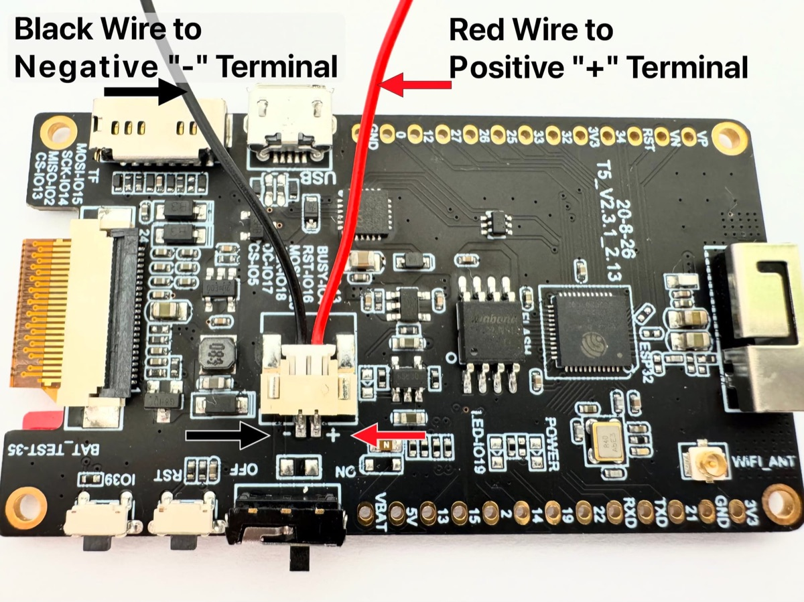
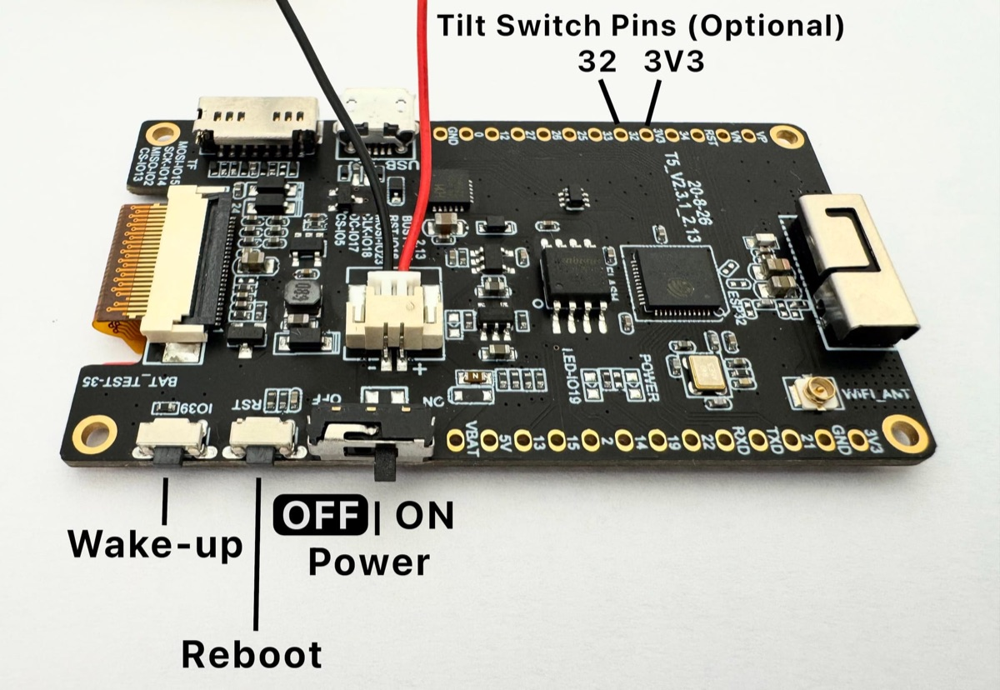

Making your very own Lightning Piggy is squealy easy. Here are the steps you need to follow:

<nav class="guide-toc" aria-label="On this page">
<p>On this page</p>
<ol>
<li><a href="#quick-start-guide">Quick start</a>, if you already have the board</li>
<li><a href="#1-source-the-parts">Source the parts</a></li>
<li><a href="#2-create-a-wallet">Create a wallet</a></li>
<li><a href="#3-flash-the-firmware">Flash the firmware</a></li>
<li><a href="#4-connect-to-and-configure-your-piggy">Connect to and configure your piggy</a></li>
<li><a href="#5-make-a-case-and-assemble-the-parts">Make a case and assemble the parts</a></li>
</ol>
</nav>

💡 **IMPORTANT:** This is not a toy. It contains small parts which could be a choking and ingestion hazard. There are also sharp edges. It should not be handled by children under 4 years of age. Assembly and use of this product is at your own risk. We take no responsibility for any losses that may be incurred.

---

## Quick Start Guide

If you already have the board, follow these steps:

1. Choose a wallet that supports Nostr Wallet Connect (NWC).
   - **For beginners:** We recommend a classic [Coinos](https://coinos.io) account - it's simple and custodial (with the option to auto-withdraw to cold storage), so you can get started quickly.
   - **For a non-custodial setup:** We recommend [LNbits](https://lnbits.com/) or [Alby Hub](https://albyhub.com/) - both support multiple friends and family accounts and are easy to use.

   Once your wallet is set up, copy your **Lightning address** and **NWC link** - you'll need both later. Your piggy only needs to see payments, so don't give the link permission to send.

2. [Flash the firmware](#3-flash-the-firmware) using the installer below. You'll need a computer with Chrome, Edge, Brave or Opera.

3. Connect to and configure your Piggy (see [Accessing Piggy's Configuration Settings](#accessing-piggys-configuration-settings) below).

---

## Full Guide

### 1. Source the parts

**Board:** LILYGO T5 V2.3.1 e-paper board with a 2.13 inch screen (DEPG0213BN) and a 9102 chip. Available direct from [LILYGO](https://www.lilygo.cc/lightningpiggy) or from resellers. The firmware also supports the 2.66 inch T5.

**Rechargeable battery:** Voltage: 3.7V Connector: JST 2pin 1.25mm. Available from...

- [Rokland](https://store.rokland.com/products/3-7v-1100mah-lithium-rechargeable-battery-1s-1c-lipo-battery-with-protection-board-with-micro-jst-1-25-plug?_pos=1&_sid=9c49fadc8&_ss=r) 1100mAh.

- [AliExpress](https://www.aliexpress.com/item/32863844546.html) 1200mAh.

- [MakerFocus](https://www.makerfocus.com/products/4pcs-952540-3-7v-1000mah-battery-with-jst1-25-connector-lithium-rechargeable-battery) 1000mAh. Note: The size of this battery 26 × 44 × 9 mm (1.02 × 1.73 × 0.35 inch) doesn't fit perfectly in the Genesis and Robotechy pig cases.

**Case:** One homemade case using materials of your choice. Check out our [cases and enclosures](/build/cases/) page if you wish to use one of ours. Please note depending on your selection there may be extra hardware to source.

**Micro USB data cable:** Any micro USB cable that carries data, not just power. You probably have one lying around.

💡 **IMPORTANT:** Improper assembly and/or the use of improper/faulty batteries can present a fire hazard. We recommend using only high quality LiPo rechargeable batteries. **Before** connecting the battery, check the connector is correctly wired. The red wire needs to align with the positive "+" terminal, and the black wire needs to align with the negative "-" terminal. If the battery you have sourced has the polarity switched, it's possible to swap the wires by carefully lifting the plastic JST connector retainers.


*Before connecting the battery, check the connector is correctly wired.*

> **Note:** The device can operate without a battery if powered via the micro USB port.

Here's an image showing your piggy's controls:


*Lightning Piggy's Controls*

If you'd like to add a tilt switch, simply solder it between pins 32 and 3V3. Any standard tilt switches will work; for example, the SW-520D ball switch is a suitable option.

### 2. Create a Wallet

Your piggy watches a Lightning wallet and shows its balance and the payments it receives. It doesn't hold any bitcoin itself: your wallet does. There are two ways to connect it:

- [**Nostr Wallet Connect (NWC)**](https://nwc.dev/): the easiest option. Many wallets support it, and you don't need a server of your own. You copy one connection link from your wallet into your piggy.
- [**LNbits**](https://lnbits.com/): a Lightning account system that you host yourself or use on a hosted server. It takes more setting up, but it's great for running several wallets, for example one per smart saver in the family. LNbits can also give you an NWC link.

#### Nostr Wallet Connect

Choose an NWC-enabled wallet and follow the provider's setup instructions. Here are some popular options:

| Wallet | Description |
|--------|-------------|
| [Alby Hub](https://albyhub.com/) | Self-custodial, open-source lightning wallet that connects to apps |
| [Cashu](https://wallet.cashu.me) | Free, open-source Bitcoin wallet that uses ecash |
| [Coinos](https://coinos.io/) | Free web wallet and payment page: classic accounts are custodial, the new v3 is self-custodial |
| [Primal](https://primal.net/) | Popular nostr client with a built-in self-custodial wallet (Spark) that works while your phone is online |
| [Zeus](https://zeusln.com/) | Self-custodial, open-source Bitcoin wallet |

In your wallet, open its Nostr Wallet Connect or connected apps settings (usually under Settings) and create a new connection for your piggy. **Your piggy never sends payments**, so it only needs permission to see your balance and payments and to receive. If your wallet asks, don't give it permission to send or pay.

Then copy the connection link. It looks like this:

```
nostr+walletconnect://…?relay=wss://relay.example.com&secret=…&lud16=you@example.com
```

**Keep this link private.** It contains a secret, so treat it like a password: only enter it on your piggy or in our QR code tools (which run entirely in your browser), and never post it online. If it does leak, delete the connection in your wallet and create a new one.

Also make a note of your wallet's Lightning address (it looks like an email address). People send sats to it, and your piggy shows it on screen as a QR code that's easy to scan.

#### LNbits

If you wish to run an LNbits wallet, please refer to our detailed [guide](/build/lnbits/) for step-by-step instructions.

### 3. Flash the firmware

Connect your Lightning Piggy to your computer with a USB data cable (some USB cables only supply power - if nothing happens, try a different cable).

<div id="flash-browser-check"></div>

<script type="module" src="https://unpkg.com/esp-web-tools@10/dist/web/install-button.js?module"></script>

<div style="text-align:center; margin: 1.5em 0;">
  <div id="flash-version" style="font-size:14px;color:#666;margin-bottom:8px;"></div>
  <esp-web-install-button manifest="https://lightningpiggy.github.io/manifests/manifest_ttgo_lilygo_2.13_and_2.66_inch_epaper_6.x.json"></esp-web-install-button>
</div>

<script>
(function() {
  fetch('https://lightningpiggy.github.io/manifests/manifest_ttgo_lilygo_2.13_and_2.66_inch_epaper_6.x.json')
    .then(function(r) { return r.json(); })
    .then(function(data) {
      var el = document.getElementById('flash-version');
      if (el && data.version) {
        el.textContent = 'Firmware ' + data.version + ' - ' + data.name;
      }
    })
    .catch(function() {});
})();
</script>

<script>
(function() {
  var el = document.getElementById('flash-browser-check');
  if (!el) return;
  if ('serial' in navigator) {
    el.innerHTML = '<div style="background:#f0fdf4;border:1px solid #bbf7d0;border-radius:12px;padding:12px 16px;margin-bottom:1em;font-size:14px;color:#166534;display:flex;align-items:center;gap:8px;"><svg width="20" height="20" fill="none" stroke="currentColor" viewBox="0 0 24 24"><path stroke-linecap="round" stroke-linejoin="round" stroke-width="2" d="M9 12l2 2 4-4m6 2a9 9 0 11-18 0 9 9 0 0118 0z"/></svg> Your browser supports the Web Serial API. You\'re good to go!</div>';
  } else {
    var ua = navigator.userAgent;
    var name = 'Your browser';
    if (ua.includes('Firefox')) name = 'Firefox';
    else if (ua.includes('Safari') && !ua.includes('Chrome')) name = 'Safari';
    el.innerHTML = '<div style="background:#fefce8;border:1px solid #fde68a;border-radius:12px;padding:12px 16px;margin-bottom:1em;font-size:14px;color:#92400e;display:flex;align-items:center;gap:8px;"><svg width="20" height="20" fill="none" stroke="currentColor" viewBox="0 0 24 24"><path stroke-linecap="round" stroke-linejoin="round" stroke-width="2" d="M12 9v2m0 4h.01m-6.938 4h13.856c1.54 0 2.502-1.667 1.732-3L13.732 4c-.77-1.333-2.694-1.333-3.464 0L3.34 16c-.77 1.333.192 3 1.732 3z"/></svg> <strong>' + name + '</strong> does not support the Web Serial API. Please use <a href="https://www.google.com/chrome/" style="color:#92400e;text-decoration:underline;">Chrome</a>, <a href="https://www.microsoft.com/edge" style="color:#92400e;text-decoration:underline;">Edge</a>, or <a href="https://brave.com/" style="color:#92400e;text-decoration:underline;">Brave</a> to flash firmware.</div>';
  }
})();
</script>

When prompted, select the serial port - usually the one labelled "CP210" (that's the USB-to-Serial chip in the device). Click **Install** and wait for the process to complete. Don't unplug your device during installation.

Once installed, the device will automatically reboot with its Wi-Fi access point enabled for approximately 20 seconds, allowing you to connect and configure the software.

### 4. Connect to and configure your piggy

You set up your piggy through its own Wi-Fi network, **Piggy Config**. It switches on for about 20 seconds after the firmware is installed, and whenever you hold the Wake-up button.

Before you start, have these details ready to copy and paste. Piggy Config has no internet access, so your phone or laptop may disconnect from it after a while.

| Connection | What you'll need |
|------------|------------------|
| **Wi-Fi** | Network name (SSID), password |
| **NWC** | NWC link (e.g., `nostr+walletconnect://...`), Lightning address |
| **or LNbits** | Server name (e.g., `https://my.lnbits.com/`), Invoice/read key |

#### Accessing Piggy's Configuration Settings

**1. Switch on Piggy Config**

If **Piggy Config** isn't in your list of Wi-Fi networks, press and hold your piggy's **IO39 (Wake-up)** button for at least 3 seconds (see the controls photo in [step 1](#1-source-the-parts)). Piggy's screen shows "Starting wireless Access Point for configuration...".

**2. Join Piggy Config**

On your phone or laptop, connect to the **Piggy Config** Wi-Fi network. Piggy's screen shows:

- The **web address** to open in your browser (e.g., `http://192.168.4.1/`)
- The **login details** - username: `piggy`, password: `oinkoink`

**3. Enter your details**

Open that web address in your browser and log in, then:

1. Enter your **Wi-Fi network** details.
2. Enter your **NWC (Nostr Wallet Connect)** or **LNbits** details.
3. Click **Save**.
4. Restart your piggy.

The device should now connect to your Wi-Fi network and display your satoshi balance, QR code to receive lightning payments, and list your recent transactions (if any).

> **Notes:**
>
> - Starting from version 5, your Piggy will remember its configuration settings even after a software update. You won't need to re-enter them, as long as you don't choose to erase the device during installation.
> - If you're powering the Piggy via USB, you can enable the "Always run webserver" option in the settings. This keeps the Wi-Fi access point active, making it easier to reconnect anytime.

### 5. Make a case and assemble the parts

Time to get creative! Build your very own Lightning Piggy case out of any material you wish to use, and assemble the parts.

💡 **IMPORTANT:** When installed correctly, the battery and/or board components should not get hot when it is being charged (i.e. the USB is connected to power and the battery is installed).

Check out our [case options](/build/cases/).

If you would like to share your design with others, please either email your creation to [oink@lightningpiggy.com](mailto:oink@lightningpiggy.com), or post a note on nostr with a photo of your piggy, including the hashtag **#zapmypiggy** for inclusion on this website.

---
Join our <a href="https://t.me/LightningPiggy" target="_blank" rel="noopener noreferrer">Telegram group</a> for help or inspiration, or to share your work with other Lightning Piggy builders.
