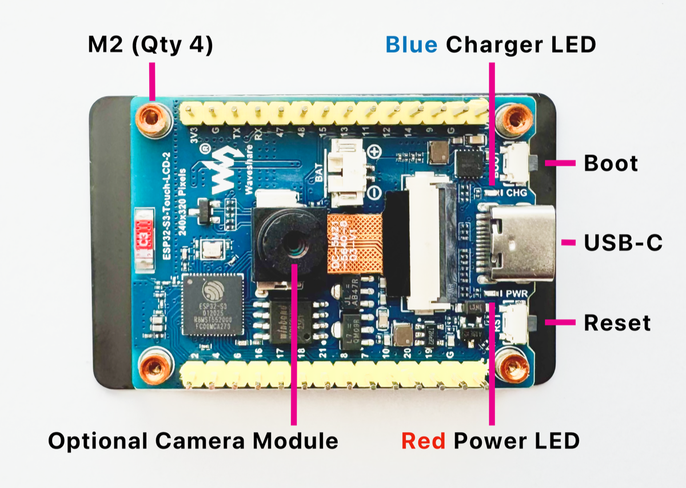

Making your very own Lightning Piggy is squealy easy. Here are the steps you need to follow:

<nav class="guide-toc" aria-label="On this page">
<p>On this page</p>
<ol>
<li><a href="#quick-start-guide">Quick start</a>, if you already have the board</li>
<li><a href="#1-source-the-parts">Source the parts</a></li>
<li><a href="#2-create-a-wallet">Create a wallet</a></li>
<li><a href="#3-flash-the-firmware">Flash the firmware</a></li>
<li><a href="#4-connect-to-wi-fi-and-configure-your-piggy">Connect to Wi-Fi and configure your piggy</a></li>
<li><a href="#5-make-a-case-and-assemble-the-parts">Make a case and assemble the parts</a></li>
</ol>
</nav>

> ⚠️ **IMPORTANT:** This is not a toy. It contains small parts which could be a choking and ingestion hazard. There are also sharp edges. It should not be handled by children under 4 years of age. Assembly and use of this product is at your own risk. We take no responsibility for any losses that may be incurred.

---

## Quick Start Guide

If you already have the board, follow these steps:

1. Choose a wallet that supports Nostr Wallet Connect (NWC).
   - **For beginners:** We recommend a classic [Coinos](https://coinos.io) account - it's simple and custodial (with the option to auto-withdraw to cold storage), so you can get started quickly.
   - **For a non-custodial setup:** We recommend [LNbits](https://lnbits.com/) or [Alby Hub](https://albyhub.com/) - both support multiple friends and family accounts and are easy to use.

   Once your wallet is set up, copy your **Lightning address** and **NWC link**. Your piggy only needs to see payments, so don't give the link permission to send.

2. Flash MicroPythonOS using the [MicroPythonOS web installer](https://install.micropythonos.com/). You'll need a computer with Chrome, Edge, Brave or Opera.

3. Connect to Wi-Fi, install the Lightning Piggy app from the MicroPythonOS App Store, then enter your wallet details in the app's settings. You can turn them into scannable QR codes with our [QR code tools](/build/#tools): see the [QR scanning tips](#qr-scanning-tips) below.

---

## Full Guide

### 1. Source the parts

**Board:** WaveShare [ESP32-S3-Touch-LCD-2](https://www.waveshare.com/esp32-s3-touch-lcd-2.htm), with a 2-inch colour touchscreen. Choose the version with the optional camera: your piggy can then scan your wallet details from a QR code, which makes setup a breeze. Available direct from WaveShare or from resellers.

**Battery (optional):** The piggy runs happily from USB. To make it portable, add a 3.7V lithium (LiPo) battery with a 2-pin MX1.25 connector (1.25mm pitch). The board charges it whenever USB is plugged in. Check the battery fits inside your case before you buy.

**Case:** One homemade case using materials of your choice. Check out our [cases and enclosures](/build/cases/) page if you wish to use one of ours. Please note depending on your selection there may be extra hardware to source.

**USB-C data cable:** Any USB-C cable that carries data, not just power. You probably have one lying around.


*The ESP32-S3-Touch-LCD-2 board*

💡 **IMPORTANT:** Improper assembly and/or the use of improper or faulty batteries can present a fire hazard. We recommend using only high quality LiPo rechargeable batteries. **Before** connecting a battery, check the connector is wired the right way round: the red wire must go to the positive "+" terminal on the board and the black wire to the negative "-" terminal. Battery connectors are not all wired the same way.

### 2. Create a Wallet

Your piggy watches a Lightning wallet and shows its balance and the payments it receives. It doesn't hold any bitcoin itself: your wallet does. There are two ways to connect it:

- [**Nostr Wallet Connect (NWC)**](https://nwc.dev/): the easiest option. Many wallets support it, and you don't need a server of your own. You copy one connection link from your wallet into your piggy.
- [**LNbits**](https://lnbits.com/): a Lightning account system that you host yourself or use on a hosted server. It takes more setting up, but it's great for running several wallets, for example one per smart saver in the family. LNbits can also give you an NWC link.

#### Nostr Wallet Connect

Choose an NWC-enabled wallet and follow the provider's setup instructions. Here are some popular options:

| Wallet | Description |
|--------|-------------|
| [Alby Hub](https://albyhub.com/) | Self-custodial, open-source lightning wallet that connects to apps |
| [Cashu](https://wallet.cashu.me) | Free, open-source Bitcoin wallet that uses ecash |
| [Coinos](https://coinos.io/) | Free web wallet and payment page: classic accounts are custodial, the new v3 is self-custodial |
| [Primal](https://primal.net/) | Popular nostr client with a built-in self-custodial wallet (Spark) that works while your phone is online |
| [Zeus](https://zeusln.com/) | Self-custodial, open-source Bitcoin wallet |

In your wallet, open its Nostr Wallet Connect or connected apps settings (usually under Settings) and create a new connection for your piggy. **Your piggy never sends payments**, so it only needs permission to see your balance and payments and to receive. If your wallet asks, don't give it permission to send or pay.

Then copy the connection link. It looks like this:

```
nostr+walletconnect://…?relay=wss://relay.example.com&secret=…&lud16=you@example.com
```

**Keep this link private.** It contains a secret, so treat it like a password: only enter it on your piggy or in our QR code tools (which run entirely in your browser), and never post it online. If it does leak, delete the connection in your wallet and create a new one.

Also make a note of your wallet's Lightning address (it looks like an email address). People send sats to it, and your piggy shows it on screen as a QR code that's easy to scan.

#### LNbits

If you wish to run an LNbits wallet, please refer to our detailed [guide](/build/lnbits/) for step-by-step instructions.

### 3. Flash the Firmware

The Lightning Piggy app runs on [MicroPythonOS](https://micropythonos.com/), a lightweight, fast and versatile operating system for microcontrollers and desktop computers.

> MicroPythonOS was created by [Thomas](https://github.com/ThomasFarstrike), our lead developer, during the development of Lightning Piggy. It grew out of a need for a fast, flexible, learner-friendly OS tailored to microcontrollers.

You'll need a laptop or desktop computer and a browser that supports Web Serial: Chrome, Edge, Brave or Opera.

1. Connect the board to your computer with your USB-C data cable.
2. Open the [MicroPythonOS web installer](https://install.micropythonos.com/) and choose the latest **unified build for ESP32-S3 devices**.
3. Click the install button, choose your board from the list of serial ports, and follow the prompts. If your board isn't listed, hold down its **Boot** button while you plug in the cable (or hold **Boot** and briefly press **Reset**), then try again.
4. When it's finished, press **Reset** if the board doesn't restart by itself.

Already running MicroPythonOS? Update it with the built-in OSUpdate app instead. The web installer does a clean install, which can erase your apps and settings.

---

### 4. Connect to Wi-Fi and Configure Your Piggy

Connect your piggy to a 2.4 GHz Wi-Fi network using the Wi-Fi app, then open the App Store and install the Lightning Piggy app.

Next, you'll need your wallet details, ideally as QR codes so you can scan them with the camera. Our [QR code tools](/build/#tools) can make them for you.

| Connection | What you'll need |
|------------|------------------|
| **NWC** | NWC link (e.g., `nostr+walletconnect://...`), Lightning address |
| **or LNbits** | Server name (e.g., `https://my.lnbits.com/`), Invoice/read key |

In the Lightning Piggy app, tap the settings cog and choose your wallet type (NWC or LNbits). Then scan your QR codes with the camera, or type the details in with the on-screen keyboard if you prefer (this takes some patience).

Once saved, your piggy connects to your wallet and shows your balance, recent payments and a QR code for receiving. This usually takes about a minute.

#### QR scanning tips

- **Make the QR as large as possible** - aim for 4-12cm (about 1.5-4.7in) on the source screen or print. Zooming in on a screen helps.
- **Scan distance** - hold the piggy around 10-25cm (about 4-10in) from the QR code.
- **Hold still** - small wobbles can confuse the scanner.
- **Black on white only** - the QR needs to be dark on a light background. Inverted QRs (for example, those shown on a device in dark mode) won't scan.

---

### 5. Make a Case and Assemble the Parts

Time to get creative! Build your very own Lightning Piggy case out of any material you wish to use, and assemble the parts.

💡 **IMPORTANT:** If you've added a battery, neither the battery nor the board should get hot while it charges (when USB is plugged in). If either does, unplug it and check the battery and its wiring.

Check out our [case options](/build/cases/).

If you would like to share your design with others, please either email your creation to [oink@lightningpiggy.com](mailto:oink@lightningpiggy.com), or post a note on nostr with a photo of your piggy, including the hashtag **#zapmypiggy** for inclusion on this website.

---
Join our <a href="https://t.me/LightningPiggy" target="_blank" rel="noopener noreferrer">Telegram group</a> for help or inspiration, or to share your work with other Lightning Piggy builders.
